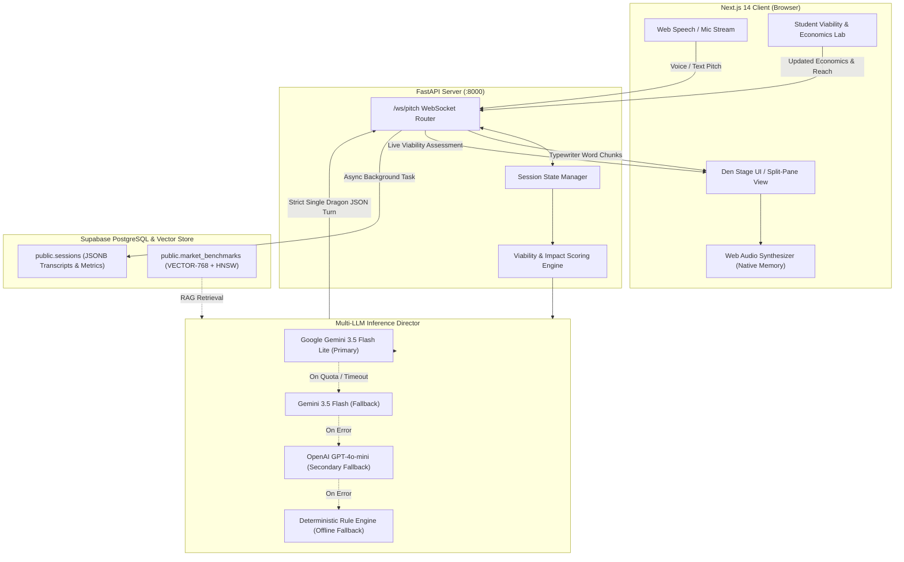

# 🐲 Dragon Tank India — Complete Project Technical Documentation & Architecture Specification

> **A Real-Time, Single-Speaker AI Mentorship & Boardroom Simulator for College Innovators, Hackathon Builders & Student Ventures**

---

## 📑 Table of Contents

1. [Executive Summary](#1-executive-summary)
2. [Target Audience & Core Problem Statement](#2-target-audience--core-problem-statement)
3. [The 4 Real-World Evaluation Pillars](#3-the-4-real-world-evaluation-pillars)
4. [Strictly Single-Speaker Architectural Rule](#4-strictly-single-speaker-architectural-rule)
5. [Full Technical Stack](#5-full-technical-stack)
6. [High-Level System Architecture](#6-high-level-system-architecture)
7. [Backend Architecture & Multi-Agent Engine](#7-backend-architecture--multi-agent-engine)
   - [7.1 Single-Speaker Director System](#71-single-speaker-director-system)
   - [7.2 Real-World Viability Assessment Engine](#72-real-world-viability-assessment-engine)
   - [7.3 Multi-LLM Cascading Fallbacks](#73-multi-llm-cascading-fallbacks)
   - [7.4 Real-Time Typewriter Streaming Protocol](#74-real-time-typewriter-streaming-protocol)
8. [The 6 Iconic Mentorship Personas](#8-the-6-iconic-mentorship-personas)
9. [Frontend Architecture & Visual Experience](#9-frontend-architecture--visual-experience)
   - [9.1 Apple VisionOS Pure Glassmorphism Design System](#91-apple-visionos-pure-glassmorphism-design-system)
   - [9.2 Split-Pane Stage: Boardroom Floor vs. Viability & Impact Radar](#92-split-pane-stage-boardroom-floor-vs-viability--impact-radar)
   - [9.3 Student Venture Economics & Viability Lab](#93-student-venture-economics--viability-lab)
   - [9.4 Targeted Dragon Mentorship & Student Action Chips](#94-targeted-dragon-mentorship--student-action-chips)
   - [9.5 Red Carpet Cinematic Entrance](#95-red-carpet-cinematic-entrance)
10. [Native In-Memory Web Audio Synthesizer](#10-native-in-memory-web-audio-synthesizer)
11. [Database Architecture & Supabase pgvector](#11-database-architecture--supabase-pgvector)
12. [WebSocket Event Protocol Specification](#12-websocket-event-protocol-specification)
13. [Repository Directory & File Breakdown](#13-repository-directory--file-breakdown)
14. [Environment Configuration & One-Command Launch](#14-environment-configuration--one-command-launch)
15. [Future Roadmap & Extensibility](#15-future-roadmap--extensibility)

---

## 1. Executive Summary

**Dragon Tank India** is a student-first, real-time AI mentorship and boardroom simulator designed specifically for college innovators, hackathon teams, and youth social ventures. 

Built with a **FastAPI** asynchronous backend and a **Next.js 14 App Router** frontend, the simulator seats student founders before six iconic mentors modeled after India’s most influential startup leaders: **Ashneer Grover**, **Aman Gupta**, **Peyush Bansal**, **Namita Thapar**, **Anupam Mittal**, and **Vineeta Singh**.

Unlike entertainment-focused television pitch shows that emphasize theatrical bidding wars, paper valuations, and royalty demands, Dragon Tank India enforces a **rigorous real-world educational standard**:
- **Fully Student-Oriented**: Grounded in the reality of campus prototypes, capstone projects, lab hardware, and student budgets.
- **Strictly One Dragon at a Time**: Zero crosstalk, zero chaotic overlapping interruptions. Each turn belongs exclusively to one mentor who conducts a deep-dive interrogation into their domain.
- **Formal Mentorship, Suggestions & Constructive Scolding**: Clear, articulate, and formal evaluation that provides actionable guidance or firm constructive scolding when fundamental business and operational mistakes are made.
- **Real-World Value Pillars**: Evaluations focus strictly on **Societal Need, Customer Benefits, Technical & Operational Feasibility, Commercial Viability & Money Making, and Scalability** rather than arbitrary television equity bargaining.

---

## 2. Target Audience & Core Problem Statement

### 🎯 Target Audience
- **College Innovators & Engineering Undergraduates**: Final-year students building capstones, AI models, robotics prototypes, or campus apps.
- **Hackathon Builders**: Weekend teams with functioning MVPs seeking real-world validation and commercial direction.
- **Student Social Entrepreneurs**: Youth addressing rural healthcare, clean water, education access, or civic challenges.

### 🛑 The Core Problem
Most student founders suffer from the **"Classroom-to-Market Disconnect"**:
1. **Vanity Valuation Obsession**: Quoting ₹20–50 Crore valuations derived from internet news rather than calculating unit costs and customer purchasing power.
2. **Confusing Code with a Company**: Believing that writing a Python algorithm or designing a Figma interface automatically equals a viable business.
3. **Negative Unit Economics**: Selling solutions below cost claiming "student discounts" and burning personal pocket money without a sustainable money-making mechanism.
4. **Feasibility Blindness**: Ignoring regulatory approvals (FSSAI, CDSCO, BIS), distributor payment cycles, and real-world logistics friction.

Dragon Tank India bridges this gap by acting as a **virtual incubator boardroom**, delivering authentic investor scrutiny before founders face real market consequences.

---

## 3. The 4 Real-World Evaluation Pillars

Every turn and final verdict is scored across four foundational pillars:

```
+------------------------------------------------------------------------------------+
|                        THE 4 REAL-WORLD VENTURE PILLARS                            |
+------------------------------------------------------------------------------------+
| 1. Societal Need & Tangible Benefits    | Does society genuinely require this?      |
|                                         | Who suffers if this product is missing?  |
| 2. Technical & Operational Feasibility | Can a student team build & maintain it?  |
|                                         | Are dependencies and regulations clear?  |
| 3. Commercial Viability & Money Making  | Does selling price exceed all costs?     |
|                                         | Is there a reliable path to gross profit?|
| 4. Scalability & Measurable Impact      | How does it scale from campus to nation? |
|                                         | What measurable human value is created?  |
+------------------------------------------------------------------------------------+
```

---

## 4. Strictly Single-Speaker Architectural Rule

In traditional group settings, multiple voices talking over each other causes confusion and dilutes actionable feedback. Dragon Tank India implements a **Strict Single-Speaker Protocol**:

1. **One Dragon Active at Any Moment**: The backend Director Engine evaluates the founder's pitch and selects **exactly one Dragon** best suited to address the statement.
2. **Deterministic Payload Clamping**: If an LLM response ever includes multiple speakers, the backend automatically clamps the response:
   ```python
   if "turns" in data and len(data["turns"]) > 1:
       data["turns"] = [data["turns"][0]]
   ```
3. **Visual State Synchronization**: During speech, only the speaking Dragon's status is set to `"speaking"` with an animated breathing amber aura and voice equalizer bars. All other five Dragons are explicitly set to `"listening"`.
4. **Zero Crosstalk**: No other Dragon interrupts or cuts off the active speaker, allowing the founder to receive focused, undivided mentorship.

---

## 5. Full Technical Stack

| Layer | Technologies & Libraries | Key Responsibilities |
|---|---|---|
| **Frontend Framework** | **Next.js 14 (App Router)**, React 18, TypeScript | SSR/CSR rendering, state management, view transitions |
| **Styling & Design System** | **Tailwind CSS 3.4**, Custom CSS Glassmorphism | Apple VisionOS frosted glass, light theme, HSL palette |
| **Motion & Animations** | **Framer Motion 14** | Red carpet door parting, unrolling carpet, popovers |
| **Iconography** | **Lucide React** | Clean, minimalist iconography across panels and badges |
| **Audio Synthesis** | **Web Audio API (Native Browser)** | Algorithmic sound generation (gongs, hisses, clicks, drops) |
| **Speech Processing** | **Web Speech API / Whisper STT** | Voice pitching, live audio level visualizer |
| **Backend Framework** | **FastAPI (Python 3.11+)**, Uvicorn | Async WebSocket server, routing, session lifecycle |
| **AI / Multi-LLM Engine** | **Google GenAI SDK** (`gemini-3.5-flash-lite`, `3.5-flash`), **OpenAI SDK** (`gpt-4o-mini`) | Sub-second single-speaker inference, viability assessment |
| **Database & Vector Store** | **Supabase (PostgreSQL 15)**, `pgvector`, HNSW Indexing | Session logging, transcripts, market benchmark search |
| **Orchestration Tooling** | Custom Async Python Director Engine | Single-speaker turn selection, formal tone evaluation |

---

## 6. High-Level System Architecture



---

## 7. Backend Architecture & Multi-Agent Engine

The backend core resides in [`backend/server.py`](./backend/server.py). It operates as an asynchronous event-driven system handling concurrent WebSocket sessions.

### 7.1 Single-Speaker Director System
When a student founder submits an idea or answer:
1. **Targeted Dragon Routing**: If the student targets a specific Dragon (e.g. *"Reply to Peyush Bansal"*), that mentor takes the floor.
2. **Context-Aware Topic Routing**: Otherwise, the system analyzes the student's statement:
   - *Unit costs, cash burn, or negative margins* $\rightarrow$ **Ashneer Grover**
   - *Consumer branding, packaging, or campus adoption* $\rightarrow$ **Aman Gupta**
   - *Technical moats, algorithms, or rural societal utility* $\rightarrow$ **Peyush Bansal**
   - *Distribution logistics, working capital, or regulations* $\rightarrow$ **Namita Thapar**
   - *Market viability, retention cohorts, or commercial scale* $\rightarrow$ **Anupam Mittal**
   - *Customer retention, repeat rates, or unit contribution* $\rightarrow$ **Vineeta Singh**
3. **Turn Clamping**: Exactly one speaker is selected. All other Dragons remain in `"listening"` mode.

### 7.2 Real-World Viability Assessment Engine
With every turn, the engine outputs structured analysis across the four pillars:
```json
{
  "viability_assessment": {
    "societal_need": "High Need | Moderate | Unproven | Low Need",
    "need_summary": "Analysis of societal need and customer pain point",
    "feasibility": "High Feasibility | Moderate | Complex Execution | High Execution Risk",
    "feasibility_summary": "Analysis of technical and operational feasibility for students",
    "commercial_viability": "Viable Dhandha | Monetization Risk | Cost Exceeds Pricing | Needs Business Model",
    "money_making_summary": "How this venture generates real money and covers costs",
    "scalability": "National TAM | Regional Scale | Campus Level | Niche Feature",
    "scalability_summary": "Assessment of scaling potential beyond campus",
    "societal_impact": "Measurable societal and human benefits",
    "key_actionable_guidance": "Immediate concrete next step or formal instruction for student",
    "tone_category": "Formal Guidance | Constructive Scolding | Feasibility Review | Money Making Check"
  }
}
```

### 7.3 Multi-LLM Cascading Fallbacks
To guarantee continuous uptime and sub-second response times:
1. **Primary**: Google Gemini 3.5 Flash Lite (`gemini-3.5-flash-lite`)
2. **Fallback 1**: Google Gemini 3.5 Flash (`gemini-3.5-flash`)
3. **Fallback 2**: OpenAI GPT-4o-mini (`gpt-4o-mini`)
4. **Offline Fallback**: Deterministic Python Rule Engine delivering structured student guidance even without network connectivity.

### 7.4 Real-Time Typewriter Streaming Protocol
The active Dragon's dialogue streams over WebSocket in 2-word bursts every 20ms, accompanied by tone badges:
- `💡 Strategic Guidance`
- `⚠️ Constructive Scolding`
- `⚙️ Feasibility Check`
- `💰 Money Making & Viability`
- `🌍 Societal Need`
- `📈 Scalability Roadmap`

---

## 8. The 6 Iconic Mentorship Personas

Each mentor focuses on specific real-world dimensions:

### 1. Ashneer Grover — *Financial Discipline & Unit Economics Mentor*
- **Domain**: Unit economics, gross margin integrity, real cash flow, eliminating subsidized pricing.
- **Formal Guidance Focus**: Teaching students that personal savings cannot fund operations; business must generate cash from Day 1.
- **Formal Scolding Trigger**: Negative gross margins, spending money before making sales, unrealistic vanity projections.
- **Tone**: Formal, direct, and uncompromising.

### 2. Aman Gupta — *Consumer Adoption & Distribution Mentor*
- **Domain**: Product packaging, campus brand virality, user delight, retail and quick-commerce channels.
- **Formal Guidance Focus**: Guiding student founders to identify one hero product rather than 10 mediocre features.
- **Tone**: Energetic, practical, street-smart yet professional.

### 3. Peyush Bansal — *Societal Impact & Technical Moat Mentor*
- **Domain**: Proprietary tech architectures, hardware automation, serving grassroots India (Tier 2/3 and rural communities).
- **Formal Guidance Focus**: Evaluating technical defensibility and helping mission-driven student prototypes scale.
- **Tone**: Patient, visionary, intellectual, and deeply empathetic.

### 4. Namita Thapar — *Operational Feasibility & Compliance Mentor*
- **Domain**: Supply chains, 60-90 day working capital cycles, FSSAI/CDSCO regulatory compliance.
- **Formal Guidance Focus**: Stress-testing whether a student team has the legal and logistical bandwidth to operate safely.
- **Tone**: Dignified, corporate, structured, and rigorous.

### 5. Anupam Mittal — *Strategic Growth & Market Viability Mentor*
- **Domain**: Total Addressable Market (TAM) sizing, user retention curves, defensible unit economics.
- **Formal Guidance Focus**: Analyzing whether a project solves an acute human need or is merely a novelty.
- **Tone**: Highly analytical, academic, structured, and strategic.

### 6. Vineeta Singh — *Unit Contribution & Retention Mentor*
- **Domain**: Cash-on-Delivery logistics, repeat cohorts, customer acquisition costs vs lifetime value.
- **Formal Guidance Focus**: Ensuring students measure organic retention before spending capital on marketing.
- **Tone**: Direct, analytical, empathetic to student hustle.

---

## 9. Frontend Architecture & Visual Experience

### 9.1 The Ishaan-UI Design System & Anti-Slop Discipline
The frontend adopts the art-directed **Ishaan-UI design philosophy**, eliminating generic template aesthetics in favor of a cohesive, authored visual world:
- **The Sovereign Chamber Metaphor**: Warm ivory parchment canvas (`#FAF8F5`), deep obsidian stone ink (`#1C1917`), warm amber lacquer accent (`#B45309`), and subtle paper grain overlay (`.grain`).
- **Editorial Display Typography with Italic Turns**: Built with Google Font **Newsreader** paired with **Plus Jakarta Sans** and **JetBrains Mono**. Big display headings feature an expressive italic second line rather than generic bold sans-serif text.
- **Anti-Slop Implementation**:
  - Zero kicker/eyebrow tags above headings (no "FEATURES" or "STUDIO PROCESS"). Headings carry their full meaning autonomously.
  - Zero emoji bullets or badges in data structures.
  - Zero purple-blue gradient clichés or floating orbs without environment.
- **Ishaan-UI Surface Tokens**:
  - `.glass`: Warm-white frosted gradient with 1px highlight and soft ambient shadow.
  - `.glass-strong`: Denser frosted pane for active elements and focus chambers.
  - `.glass-inset`: Tactile recessed wells for sliders, chips, and input bars.

### 9.2 Custom Hand-Drawn SVG Icon Set (`IshaanIcons.tsx`)
Rather than relying on stock icon libraries, all core symbols are drawn by hand in one consistent voice on a 24×24 grid with 1.4px stroke, round caps/joins, and intentional open gaps:
- `IconFlame`: The boardroom ember.
- `IconCompass`: Societal Need & Purpose.
- `IconGear`: Technical & Operational Feasibility.
- `IconCoins`: Unit Economics & Money Making.
- `IconAscend`: Scalability & Growth.
- `IconSeal`: Formal Verdicts & Chamber Rulings.
- `IconArrow`: Curved-shaft forward gesture.
- `IconCheckCircle`: Open-gap verified status indicator.

### 9.3 Bespoke Data Visuals: The Bezel Dial (`BezelDial.tsx`)
In accordance with Ishaan-UI principles (*data visuals should be custom, never default chart skins*), the application implements a dedicated SVG Bezel Dial:
- 60 hairline tick marks around a ring.
- Sweeping status arc with spring transitions.
- Large Newsreader display numerals displaying unit contribution and gross margin.

### 9.4 Split-Pane Stage: Boardroom Floor vs. Viability & Impact Radar
Located in [`frontend/components/PitchBoardroom.tsx`](./frontend/components/PitchBoardroom.tsx):
- **Left Stage (60% Desktop Width)**:
  - Scrollable transcript displaying student statements and the single speaking Dragon's guidance.
  - Typographical status seals instead of emoji tags.
  - Bespoke action chips: `Societal Need`, `Money Making & Costs`, `Technical Feasibility`, `Scalability Plan`, `Request Formal Critique`.
- **Right Stage (40% Desktop Width) — Student Venture Viability & Impact Radar**:
  - **Bezel Dial**: Real-time margin and viability gauge.
  - **Mentor Formal Guidance Card**: Large display quotation in Newsreader italic serif.
  - **The 4 Real-World Pillars Grid**: Societal Need, Feasibility, Money Making, and Scalability with custom hand-drawn glyphs.
  - **Measurable Societal & Human Impact Card**: Community and human value tracking.
  - **Formal Viability Ruling Action**: Triggers the panel's comprehensive final evaluation with an authentic seal.

### 9.5 Student Venture Economics & Viability Lab
Located on [`frontend/components/HomePage.tsx`](./frontend/components/HomePage.tsx):
- Embedded **Bezel Dial** displaying live Gross Margin %.
- Interactive tactile sliders for **Direct Unit Cost (₹)**, **Customer Pricing (₹)**, and **Target Community Reach (Users)**.
- Computes live: Gross Margin %, Break-even Volume, and Net Monthly Run-Rate.
- Live dynamic Dragon feedback preview with formal guidance, suggestions, or scolding based on real math.

### 9.5 Red Carpet Cinematic Entrance
Implemented in [`frontend/components/RedCarpetTransition.tsx`](./frontend/components/RedCarpetTransition.tsx):
- Sub-bass impact boom (36 Hz), parting hydraulic stage doors, rolling red carpet, and flash strobes before transitioning to the boardroom floor.

---

## 10. Native In-Memory Web Audio Synthesizer

Located in [`frontend/components/SoundEffects.ts`](./frontend/components/SoundEffects.ts):
- Zero external MP3 or WAV dependencies.
- Synthesizes sub-bass booms, hydraulic hisses, boardroom gongs, and camera clicks in browser memory using the Web Audio API.

---

## 11. Database Architecture & Supabase pgvector

Defined in [`supabase/schema.sql`](./supabase/schema.sql):
- `public.sessions`: Stores session transcripts, viability metrics, and mentorship logs.
- `public.market_benchmarks`: Provides vector-indexed Indian market benchmarks for RAG retrieval.

---

## 12. WebSocket Event Protocol Specification

All communication between client and server occurs over `/ws/pitch`.

### Client Messages:
- `pitch_text`: Student submits pitch with target mentor and current metrics.
- `founder_answer`: Student answers an active Dragon's question.
- `call_for_decisions`: Triggers the final formal viability ruling.
- `reset_session`: Resets the session state and metrics.

### Server Messages:
- `session_init`: Floor initialization with seated Dragons and initial pillar metrics.
- `chat_message`: Acknowledgment of student input.
- `moderator_evaluating`: Status indicator while the Dragon prepares feedback.
- `dragon_stream_chunk`: High-speed typewriter token streaming.
- `dragon_turn`: Finalized single-speaker message, updated 4-pillar metrics, and dragon statuses.

---

## 13. Repository Directory & File Breakdown

```
dragon_tank/
├── .env                              # Master environment variables (API keys, ports)
├── README.md                         # Quick start documentation
├── abc.md                            # Comprehensive project technical documentation (This file)
├── server.py                         # Root launcher proxying backend.server:app
├── page.tsx                          # Root shortcut re-exporting frontend/app/page.tsx
├── start.sh                          # One-command dual server bash startup script
│
├── backend/                          # FastAPI Backend Application
│   ├── .env                          # Local backend environment configuration
│   ├── .env.example                  # Template configuration file
│   ├── requirements.txt              # Python package dependencies
│   └── server.py                     # 957 lines: FastAPI, Single-Speaker Director, WebSockets, Viability Engine
│
├── frontend/                         # Next.js 14 App Router Application
│   ├── .env.local                    # Client-side environment endpoints
│   ├── package.json                  # Next.js dependencies and scripts
│   ├── tailwind.config.js            # Tailwind theme tokens and animations
│   ├── tsconfig.json                 # TypeScript compiler configuration
│   │
│   ├── app/                          # Next.js App Directory
│   │   ├── globals.css               # Design system: Glassmorphism tokens, keyframes
│   │   ├── layout.tsx                # HTML root wrapper, fonts, metadata
│   │   └── page.tsx                  # Top-level screen coordinator ('home' vs 'pitch' view)
│   │
│   └── components/                   # Core Interactive UI Components
│       ├── HomePage.tsx              # 840 lines: Landing page, Viability & Economics Lab, Mentors
│       ├── PitchBoardroom.tsx        # 1,280 lines: Split-pane boardroom, single-speaker HUD, Viability Radar
│       ├── RedCarpetTransition.tsx   # 355 lines: Cinematic red carpet sequence
│       ├── SoundEffects.ts           # 152 lines: Native Web Audio synthesizer engine
│       └── dragonDialogues.ts        # 302 lines: Library of iconic dialogues & profiles
│
└── supabase/                         # Supabase PostgreSQL Database Setup
    └── schema.sql                    # 213 lines: Tables, pgvector HNSW indexing, RLS policies, RPCs
```

---

## 14. Environment Configuration & One-Command Launch

### 14.1 Backend Environment Setup (`backend/.env` or `.env`)
```env
# Google Gemini API Key (Sub-second Dragon Engine)
GEMINI_API_KEY=your_gemini_api_key_here
GEMINI_MODEL=gemini-3.5-flash-lite

# OpenAI API Key (Multi-LLM Secondary Fallback)
OPENAI_API_KEY=your_openai_api_key_here
OPENAI_MODEL=gpt-4o-mini

# Supabase Credentials (Session storage & pgvector)
SUPABASE_URL=https://your-project.supabase.co
SUPABASE_KEY=your_supabase_anon_or_service_key_here

# Server Bindings
PORT=8000
HOST=0.0.0.0
```

### 14.2 One-Command Launch (`./start.sh`)
```bash
chmod +x start.sh
./start.sh
```

---

## 15. Future Roadmap & Extensibility

1. **Student Team Multi-Device Pitching**: Co-founders on multiple devices pitching simultaneously via synchronized WebSockets.
2. **Capstone PDF & Prototype Deck Parser**: Automated extraction of unit costs, hardware schematics, and code repos directly into mentor context.
3. **Downloadable Student Viability Report**: Generating a PDF scorecard with the 4 pillars, mentor feedback, and concrete next steps.
4. **Campus Incubator Mode**: Allowing university entrepreneurship cells to host virtual pitch competitions with custom rubrics.

---

*Documentation compiled and maintained for Dragon Tank India.*
