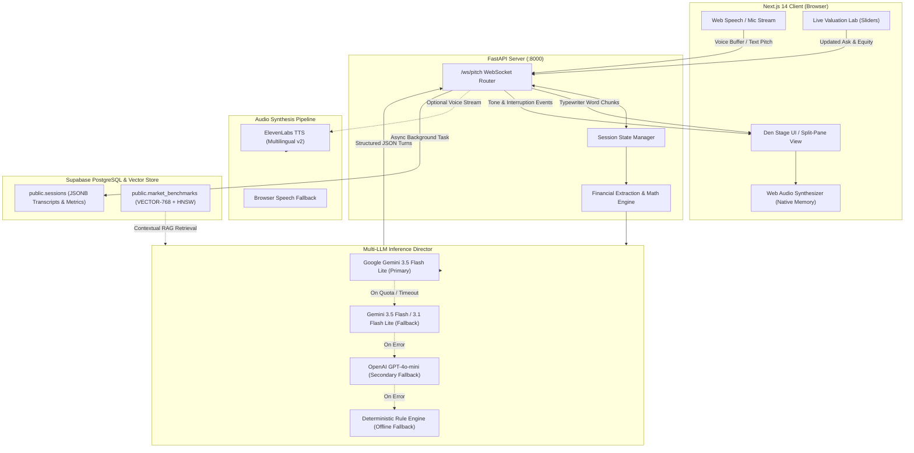

# 🐲 Dragon Tank India — Complete Project Technical Documentation & Architecture Specification

> **A Real-Time, Multi-Agent AI Voice & Text Boardroom Simulator for College Innovators, Hackathon Builders & Early-Stage Startups**

---

## 📑 Table of Contents

1. [Executive Summary](#1-executive-summary)
2. [Target Audience & Problem Statement](#2-target-audience--problem-statement)
3. [Full Technical Stack](#3-full-technical-stack)
4. [High-Level System Architecture](#4-high-level-system-architecture)
5. [Backend Architecture & Multi-Agent Engine](#5-backend-architecture--multi-agent-engine)
   - [5.1 Multi-LLM Routing & Automated Fallbacks](#51-multi-llm-routing--automated-fallbacks)
   - [5.2 Zero-Invention Financial Integrity Engine](#52-zero-invention-financial-integrity-engine)
   - [5.3 Master Boardroom Director System](#53-master-boardroom-director-system)
   - [5.4 Real-Time Typewriter Streaming Protocol](#54-real-time-typewriter-streaming-protocol)
6. [The 6 Iconic Dragon Personas](#6-the-6-iconic-dragon-personas)
7. [Frontend Architecture & Visual Experience](#7-frontend-architecture--visual-experience)
   - [7.1 Apple VisionOS Pure Glassmorphism Design System](#71-apple-visionos-pure-glassmorphism-design-system)
   - [7.2 Split-Pane Stage: Live Floor vs. Financial HUD](#72-split-pane-stage-live-floor-vs-financial-hud)
   - [7.3 Interactive Student Valuation Lab](#73-interactive-student-valuation-lab)
   - [7.4 Targeted Dragon Replies & Student Action Chips](#74-targeted-dragon-replies--student-action-chips)
   - [7.5 Red Carpet Cinematic Entrance](#75-red-carpet-cinematic-entrance)
8. [Native In-Memory Web Audio Synthesizer](#8-native-in-memory-web-audio-synthesizer)
9. [Database Architecture & Supabase pgvector](#9-database-architecture--supabase-pgvector)
10. [WebSocket Event Protocol Specification](#10-websocket-event-protocol-specification)
11. [Repository Directory & File Breakdown](#11-repository-directory--file-breakdown)
12. [Environment Configuration & One-Command Launch](#12-environment-configuration--one-command-launch)
13. [Future Roadmap & Extensibility](#13-future-roadmap--extensibility)

---

## 1. Executive Summary

**Dragon Tank India** is an enterprise-grade, real-time AI boardroom simulator engineered to replicate the high-stakes pressure, strategic interrogation, and banter of India's premier venture reality show (*Shark Tank India*). 

Built with a **FastAPI** asynchronous backend and a **Next.js 14 App Router** frontend, the simulator seats founders before six dynamically reactive AI Dragon personas modeled after India’s most iconic startup titans: **Ashneer Grover**, **Aman Gupta**, **Peyush Bansal**, **Namita Thapar**, **Anupam Mittal**, and **Vineeta Singh**.

Unlike generic chatbot wrappers, Dragon Tank India implements:
- **Autonomous Multi-Agent Turn Orchestration** where Dragons converse, interrupt one another, challenge assumptions, and debate valuations.
- **Strict Financial Integrity Enforcement**, ensuring AI agents never hallucinate or invent financial numbers that founders have not stated.
- **Real-Time Token Streaming over WebSockets** with sub-second latency powered by **Google Gemini 3.5 Flash Lite** with automated fallback to **OpenAI GPT-4o-mini**.
- **Native In-Memory Web Audio Synthesizer** generating cinematic sub-bass hits, hydraulic door releases, camera flash pops, and boardroom gongs without loading any external MP3/WAV assets.
- **Apple VisionOS Light-Mode Glassmorphism** built with pure Tailwind CSS and Framer Motion.

---

## 2. Target Audience & Problem Statement

### 🎯 Target Audience
- **College Innovators & Engineering Students**: Building final-year capstone projects, AI wrappers, IoT prototypes, and campus applications.
- **Hackathon Winners & Builders**: Technical teams with working MVPs who lack business acumen, cap table awareness, and distribution models.
- **Early-Stage & Pre-Seed Founders**: Entrepreneurs preparing to step before Indian angel syndicates, venture capitalists, or accelerator demo days.

### 🛑 The Core Problem
Most college builders suffer from **"Prototype-to-Startup Delusion"**:
1. **Absurd Paper Valuations**: Demanding ₹50 Lakhs to ₹2 Crores at ₹20–50 Crore valuations with zero revenue, zero paying users, and no legal entity.
2. **Confusing Projects with Businesses**: Believing that building a machine learning model or mobile app automatically constitutes a viable commercial company.
3. **Lack of Customer Validation**: Conducting surveys only among college friends and roommates rather than getting real paying customers who hand over cash or UPI payments.
4. **Cap Table Dilution Blindness**: Willing to give away 25–40% equity at ideation stage, crippling future venture rounds.

Dragon Tank India acts as a **crucible and educational accelerator**: providing brutal honesty, actionable frameworks, and constructive mentorship before founders make fatal mistakes in front of real investors.

---

## 3. Full Technical Stack

| Layer | Technologies & Libraries | Key Responsibilities |
|---|---|---|
| **Frontend Framework** | **Next.js 14 (App Router)**, React 18, TypeScript | SSR/CSR rendering, state management, view transitions |
| **Styling & Design System** | **Tailwind CSS 3.4**, Custom CSS Glassmorphism | Apple VisionOS frosted glass, light theme, HSL palette |
| **Motion & Animations** | **Framer Motion 14** | Red carpet door parting, unrolling carpet, popovers |
| **Iconography** | **Lucide React** | Clean, minimalist iconography across panels and badges |
| **Audio Synthesis** | **Web Audio API (Native Browser)** | Algorithmic sound generation (gongs, hisses, clicks, drops) |
| **Speech Processing** | **Web Speech API / Whisper STT** | Voice pitching, live audio level visualizer |
| **Backend Framework** | **FastAPI (Python 3.11+)**, Uvicorn | Async WebSocket server, routing, session lifecycle |
| **AI / Multi-LLM Engine** | **Google GenAI SDK** (`gemini-3.5-flash-lite`, `3.5-flash`, `3.1-flash-lite`), **OpenAI SDK** (`gpt-4o-mini`) | Sub-second multi-agent inference, persona simulation |
| **Voice Synthesis** | **ElevenLabs API** (`eleven_multilingual_v2`) | Voice generation with individual voice ID mappings |
| **Database & Vector Store** | **Supabase (PostgreSQL 15)**, `pgvector`, HNSW Indexing | Session logging, transcripts, market benchmark search |
| **Orchestration Tooling** | Custom Async Python Director Engine | Multi-dragon turns, crosstalk, tone badge evaluation |

---

## 4. High-Level System Architecture



---

## 5. Backend Architecture & Multi-Agent Engine

The backend core resides in [`backend/server.py`](file:///Users/keshav/shark%20tank/backend/server.py). It operates as an asynchronous event-driven system handling concurrent WebSocket sessions.

### 5.1 Multi-LLM Routing & Automated Fallbacks
To achieve sub-second conversational latency required for realistic human simulation, the engine uses an automated cascade fallback system:

1. **Tier 1 (Sub-500ms): Google Gemini 3.5 Flash Lite**
   - Configured with `temperature=0.75` and `response_mime_type="application/json"`.
   - Optimized for fast JSON generation and conversational banter.
2. **Tier 2 (Fallback): Google Gemini 3.5 Flash & 3.1 Flash Lite**
   - Invoked transparently if the primary model encounters rate limits or latency spikes.
3. **Tier 3 (Fallback): OpenAI GPT-4o-mini**
   - High-reliability JSON mode fallback via the official OpenAI client.
4. **Tier 4 (Offline): Deterministic Rule-Based Boardroom Engine**
   - Safeguards against complete internet disconnection or invalid API keys, delivering structured turns without crashing.

### 5.2 Zero-Invention Financial Integrity Engine
A core failure mode of generic LLMs in financial applications is making up numbers (e.g., assuming a founder is asking for ₹1 Crore for 1% when the founder never stated an ask). Dragon Tank India solves this with a **Strict Financial Integrity Prompt Directive**:
- If the founder has **not** stated their ask or revenue:
  - `ask`: `"Not stated yet"`
  - `equity`: `"Not stated yet"`
  - `valuation`: `"Awaiting founder pitch"`
  - `revenue`: `"Not stated yet"`
  - `arr`: `"Not stated yet"`
  - `implied_multiple`: `"Awaiting ask & numbers"`
- **Proactive Interrogation Trigger**: When financial variables are empty, active Dragons **must proactively grill** the founder:
  > *"Bhai, what is your ask? You came to the boardroom without stating how much money you want and what your revenue is. First tell us the math, tab baat aage badhegi!"*
- When the founder explicitly speaks numbers (e.g., *"We want 20 Lakhs for 5% with 2 Lakh monthly sales"*), the engine parses them and performs deterministic valuation calculations:
  $$\text{Post-Money Valuation} = \frac{\text{Ask Amount}}{\text{Equity Dilution \%}} \times 100$$
  $$\text{Pre-Money Valuation} = \text{Post-Money Valuation} - \text{Ask Amount}$$
  $$\text{Annual Run-Rate ARR} = \text{Monthly Revenue} \times 12$$
  $$\text{Implied Multiple} = \frac{\text{Post-Money Valuation}}{\text{ARR}}$$

### 5.3 Master Boardroom Director System
The Director engine orchestrates 2 to 3 sequential turns per user exchange:
- **Turn 1 (Direct Response)**: If the founder targets a specific Dragon (e.g., clicking *Reply to Peyush Bansal*), that targeted Dragon **must speak first**.
- **Turn 2 (Crosstalk / Interruption)**: A contrasting Dragon chimes in, building upon or roasting the previous Dragon's advice.
- **Turn 3 (Validation or Exit)**: A third Dragon asks an operational question or bows out with `"I AM OUT"` citing an educational reason.

### 5.4 Real-Time Typewriter Streaming Protocol
Instead of dumping full paragraphs at once, the backend emits `dragon_stream_chunk` events over the WebSocket in 2-word bursts every 20 milliseconds:
```json
{
  "type": "dragon_stream_chunk",
  "stream_id": "stream_roaster_1710500000",
  "dragon_id": "roaster",
  "speaker": "Ashneer Grover",
  "chunk": "Yeh sab ",
  "action": "roast",
  "tone_badge": "🔥 Brutal Roast",
  "is_interruption": false,
  "llm_provider": "Google Gemini (gemini-3.5-flash-lite)"
}
```

---

## 6. The 6 Iconic Dragon Personas

Each Dragon is modeled with deep domain expertise, signature catchphrases, distinct speech cadence, and specific triggers:

```
+------------------------------------------------------------------------------------+
|                                 THE 6 DRAGONS                                      |
+------------------------------------------------------------------------------------+
| 1. Ashneer Grover   | The Dhandha Roaster     | Unit economics, cash burn, profit |
| 2. Aman Gupta       | Marketing Titan         | Packaging, swag, campus virality   |
| 3. Peyush Bansal    | Tech Visionary          | Moats, software code, Tier-2 TAM   |
| 4. Namita Thapar    | Pharma & Operations     | Compliance, 90-day credit cycles   |
| 5. Anupam Mittal    | Valuation Chessmaster   | Cap table hygiene, ARR multiples   |
| 6. Vineeta Singh    | D2C & Retail Hustler    | RTO courier loss, repeat cohorts   |
+------------------------------------------------------------------------------------+
```

### 1. Ashneer Grover — *The Unfiltered Roaster & Dhandha Defender*
- **Archetype**: Fintech Unicorn Founder (BharatPe).
- **Core Focus**: Positive EBITDA, gross margins $>60\%$, real bank balance, zero sugarcoating.
- **Iconic Dialogues**:
  - *"Yeh sab doglapan hai."*
  - *"Bhai tu dhandha band kar aur naukri dhoondh, tere bas ki nahi hai."*
  - *"Bhai kya phoonk ke aaye ho? 20L revenue pe 50 Crore valuation?"*
  - *"Hawa mein valuation mat banao, balance sheet dikhao."*
  - *"Bhai tere mein dhandhe ki bhookh hai, tu banayega paisa."* (Honest praise for real bootstrapped hustle).
- **Behavioral Dynamic**: He is **not** an angry caricature. If a student shows honest awareness, verified paying users, and high margins, Ashneer praises them and offers a clean deal. If a student presents a classroom slide deck at a ₹20 Cr valuation, he delivers an uncompromising reality check.

### 2. Aman Gupta — *The Brand & Consumer Pulse Dragon*
- **Archetype**: boAt Co-founder & Chief Marketing Officer.
- **Core Focus**: Brand recall, modern unboxing experience, hero SKU clarity, quick commerce (Blinkit/Zepto), viral youth swag.
- **Iconic Dialogues**:
  - *"Dhandha brand se banta hai. Hum bhi bana lenge!"*
  - *"Bhai packaging dekh ke lag raha hai 1990 ka sarkari dabba hai."*
  - *"Hero product kya hai tera? Har cheez bechega toh kirana ban jayega."*
  - *"Arre Ashneer bhai, thoda saans le! Har cheez dukaan nahi hoti!"*
- **Behavioral Dynamic**: Street-smart Delhi Hinglish, defends founders against excessive financial bullying, crafts joint syndicate deals with Peyush.

### 3. Peyush Bansal — *The Tech Visionary & Grassroots Enabler*
- **Archetype**: Lenskart Founder & CEO.
- **Core Focus**: DeepTech moats, hardware/software automation, customer empathy, Tier-2/3 Bharat scalability.
- **Iconic Dialogues**:
  - *"Tech moat kya hai? Agar Swiggy ya Blinkit ne copy kar liya toh?"*
  - *"Aapka purpose aur intent bahut saaf hai, dil jeet liya aapne."*
  - *"Ashneer, let him speak. Don't demoralize the founder, let's understand the technology."*
  - *"Technology se hum unit cost 50% kam kar sakte hain."*
- **Behavioral Dynamic**: Calm, intellectual, patient listener who protects student inventors and looks beyond short-term revenue to evaluate proprietary algorithms and hardware architecture.

### 4. Namita Thapar — *The Healthcare Titan & Operational Realist*
- **Archetype**: Emcure Pharmaceuticals Executive Director.
- **Core Focus**: FSSAI/CDSCO regulatory compliance, clinical trials, distributor working capital cycles (60–90 days credit), corporate governance.
- **Iconic Dialogues**:
  - *"Is category mein meri expertise nahi hai, so for that reason I am out."*
  - *"Working capital cycle 90 din ka hai, cash flow phans jayega."*
  - *"Yeh clinical trial claims certified hain ya placebo marketing hai?"*
  - *"Agar margins >70% hain aur science solid hai, I can open 10,000 pharmacy doors."*
- **Behavioral Dynamic**: Highly articulate corporate English, merciless on unscientific health/pharma claims, steps out quickly when businesses fall outside her core distribution strengths.

### 5. Anupam Mittal — *The Strategic Chessmaster & Valuation Guru*
- **Archetype**: Shaadi.com / People Group Founder.
- **Core Focus**: India 1 (30M affluent) vs India 2 (100M aspirational) TAM sizing, LTV:CAC ratios, cap table dilution hygiene, venture math.
- **Iconic Dialogues**:
  - *"Chalo math karte hain. TAM, LTV aur Unit Economics."*
  - *"Aapki cap table toxic hai, early stage pe itna dilute kar diya?"*
  - *"Multiple reality check: D2C trades at 2x-3x ARR, yeh valuation bubble hai."*
  - *"Ashneer, tu har business ko sabzi mandi samajhta hai!"*
- **Behavioral Dynamic**: Analytical, intellectual, structured venture capitalist lens; loves calculating market size and cap table risks.

### 6. Vineeta Singh — *The D2C Unit Economics & Retail Hustle Queen*
- **Archetype**: SUGAR Cosmetics Co-founder & CEO.
- **Core Focus**: Customer cohort repeat curves, Cash-on-Delivery (COD) Return-to-Origin (RTO) courier bleeding, General Trade (GT) vs Modern Trade (MT) distributor margins.
- **Iconic Dialogues**:
  - *"Repeat customer cohort sirf 15% kyun hai?"*
  - *"COD orders mein 25% RTO hoga, courier charges mein margin khatam."*
  - *"Super stockist 6%, distributor 10%, retailer 30%, aapke paas bacha kya?"*
  - *"I know what it feels like when runway is 2 weeks and payroll is due."*
- **Behavioral Dynamic**: Fast-paced Mumbai hustle, empathetic to founders who fight through operational near-death experiences, deeply analytical on unit contribution margins.

---

## 7. Frontend Architecture & Visual Experience

### 7.1 Apple VisionOS Pure Glassmorphism Design System
The frontend implements an ultra-premium, light-mode translucent aesthetic defined in [`frontend/app/globals.css`](file:///Users/keshav/shark%20tank/frontend/app/globals.css):
- **Glass Dock** (`.glass-dock`): `backdrop-filter: blur(36px) saturate(190%)`, high elevation with floating drop shadows.
- **Glass Panel** (`.glass-panel`): `background: rgba(255, 255, 255, 0.52)` with `backdrop-filter: blur(28px)` and crisp 1px borders (`rgba(255, 255, 255, 0.82)`).
- **Dragon Speaking Pulse** (`.dragon-speaking-glass`): Amber-tinted glowing box shadow that breathes while a Dragon's voice or text chunk streams.
- **Animated Audio Equalizer Bars** (`.eq-bar-1` through `.eq-bar-5`): Dynamic CSS keyframe animations visually demonstrating live speech.

### 7.2 Split-Pane Stage: Live Floor vs. Financial HUD
Located in [`frontend/components/PitchBoardroom.tsx`](file:///Users/keshav/shark%20tank/frontend/components/PitchBoardroom.tsx):
- **Left Stage (60% Desktop Width)**:
  - Scrollable boardroom transcript displaying founder messages and Dragon responses.
  - Avatar initials with brand accent colors.
  - Action tags: `🔥 Brutal Roast`, `💡 Student Guidance`, `⚡ Interruption & Banter`, `🚪 Stepped Out`, `💰 Deal Offer`.
  - Individual **"Reply to Dragon"** button on each speech bubble.
- **Right Stage (40% Desktop Width)**:
  - **Pre-Money / Post-Money Valuation Card**: Computes valuation and equity dilution in real time.
  - **4 Essential Numbers Grid**: Monthly Revenue, Annualized ARR, Gross Margin %, CAC & Repeat Rate.
  - **Strategic Valuation Roadmap**: Contextual guidance on what milestones or pilot experiments are required before raising seed venture capital.
  - **Extended Deal Offers**: Interactive list of active Dragon term sheets with an **"Accept Deal"** button that triggers deal celebration bells.

### 7.3 Interactive Student Valuation Lab
Located on [`frontend/components/HomePage.tsx`](file:///Users/keshav/shark%20tank/frontend/components/HomePage.tsx):
- Dual interactive sliders scaled specifically for student founders:
  - **Funding Ask Slider**: ₹5 Lakhs to ₹1 Crore.
  - **Equity Dilution Slider**: 1% to 30%.
- Instant computation of Pre-Money and Post-Money valuations in ₹ Crores.
- **Live Dynamic Dragon Reaction Card**: As the founder moves sliders, the UI reacts instantaneously:
  - Valuation $> ₹25 \text{ Cr}$: Ashneer roasts the lack of campus validation.
  - Equity Dilution $\ge 15\%$: Aman warns against early cap table dilution.
  - Valuation $\le ₹10 \text{ Cr}$ with realistic equity: Peyush validates the student seed structure.

### 7.4 Targeted Dragon Replies & Student Action Chips
- **Targeted Reply Bar**: Founder can switch from `🌐 All Dragons (Panel)` to any individual Dragon (`Ashneer`, `Aman`, `Peyush`, `Namita`, `Anupam`, `Vineeta`).
- **Student Founder Quick Chips**: One-click replies for common student scenarios:
  1. `🎓 Student Pilot`: *"We tested this with 120 college students on our campus and 40% use it daily."*
  2. `🔍 Customer Validation`: *"We conducted 35 customer interviews. 18 students paid ₹199 each via UPI for our beta."*
  3. `💡 Project to Startup`: *"How do you recommend we transition this from a college capstone project into a real commercial venture?"*
  4. `📊 Honest Valuation`: *"Dragons, help me understand what an honest pre-seed valuation is for our current stage."*
  5. `🛡️ Tech Architecture`: *"The core algorithms and hardware prototype were built entirely by our student team in the campus lab."*
  6. `💰 Campus Seed Ask`: *"We are asking for ₹15 Lakhs for 7% equity to fund server costs and our 3-campus pilot."*

### 7.5 Red Carpet Cinematic Entrance
Implemented in [`frontend/components/RedCarpetTransition.tsx`](file:///Users/keshav/shark%20tank/frontend/components/RedCarpetTransition.tsx):
- Triggered when entering the boardroom from the lobby.
- Animated stage progression:
  1. `0.0s`: Deep sub-bass impact boom (36 Hz).
  2. `0.2s`: Hydraulic stage doors part open.
  3. `0.8s`: Red carpet rolls forward towards the stage.
  4. `1.8s & 2.1s`: Camera strobe flash effect with shutter audio clicks.
  5. `3.4s`: Seamless transition into the live boardroom floor.

---

## 8. Native In-Memory Web Audio Synthesizer

The audio engine in [`frontend/components/SoundEffects.ts`](file:///Users/keshav/shark%20tank/frontend/components/SoundEffects.ts) is a masterclass in frontend performance: **it contains zero external MP3 or WAV dependencies**. All dramatic sound effects are synthesized mathematically in browser memory using the **Web Audio API**:

```
+-----------------------------------------------------------------------------------+
|                        SYNTHESIZED AUDIO SOUNDBOARD                               |
+-----------------------------------------------------------------------------------+
| 1. Sub-Bass Impact Boom      | Sine wave 110Hz -> 36Hz with exponential decay     |
| 2. Hydraulic Door Hiss       | Math.random() White Noise + Biquad Bandpass Filter |
| 3. Dragon Tank Gong Chime    | Harmonic frequencies (220, 440, 659.25, 880 Hz)    |
| 4. Paparazzi Flash Clutter   | Square wave bursts at 1800Hz with fast dampening   |
| 5. "I'M OUT" Dramatic Stamp  | Detuned dual square waves (160Hz + 85Hz)           |
| 6. Deal Celebration Chimes   | Pentatonic ascending arpeggio (C5 -> C6)           |
+-----------------------------------------------------------------------------------+
```

### Benefits of In-Memory Synthesis:
- **Zero Network Latency**: Sounds trigger instantaneously with 0ms buffering.
- **Zero Asset Breakage**: No 404 errors, CDN failures, or missing audio files.
- **Microscopic Bundle Size**: Less than 5 KB of TypeScript code replaces megabytes of audio assets.

---

## 9. Database Architecture & Supabase pgvector

Database scripts are defined in [`supabase/schema.sql`](file:///Users/keshav/shark%20tank/supabase/schema.sql).

### 9.1 Sessions Table (`public.sessions`)
Stores all historical pitches, financial metrics, and full multi-agent dialogue transcripts:
```sql
CREATE TABLE IF NOT EXISTS public.sessions (
    id UUID PRIMARY KEY DEFAULT gen_random_uuid(),
    session_id TEXT UNIQUE NOT NULL,
    transcript JSONB NOT NULL DEFAULT '[]'::jsonb,
    business_metrics JSONB NOT NULL DEFAULT '{}'::jsonb,
    created_at TIMESTAMP WITH TIME ZONE DEFAULT timezone('utc'::text, now()) NOT NULL,
    updated_at TIMESTAMP WITH TIME ZONE DEFAULT timezone('utc'::text, now()) NOT NULL
);

CREATE INDEX IF NOT EXISTS idx_sessions_session_id ON public.sessions (session_id);
```

### 9.2 Indian Market Benchmarks Table (`public.market_benchmarks`)
Provides domain knowledge retrieval (RAG) for Dragons when scrutinizing market valuations:
```sql
CREATE TABLE IF NOT EXISTS public.market_benchmarks (
    id BIGSERIAL PRIMARY KEY,
    industry TEXT NOT NULL,
    stat TEXT NOT NULL,
    metadata JSONB DEFAULT '{}'::jsonb,
    embedding VECTOR(768),
    created_at TIMESTAMP WITH TIME ZONE DEFAULT timezone('utc'::text, now()) NOT NULL
);

-- Fast Approximate Nearest Neighbor (HNSW) Vector Index
CREATE INDEX IF NOT EXISTS idx_market_benchmarks_embedding 
ON public.market_benchmarks 
USING hnsw (embedding vector_cosine_ops);
```

### 9.3 Hybrid Vector & Fuzzy Search RPC (`match_benchmarks`)
Allows simultaneous vector semantic search and keyword fallback in PostgreSQL:
```sql
CREATE OR REPLACE FUNCTION public.match_benchmarks (
    query_text TEXT DEFAULT '',
    query_embedding VECTOR(768) DEFAULT NULL,
    match_count INT DEFAULT 1
)
RETURNS TABLE (
    id BIGINT,
    industry TEXT,
    stat TEXT,
    similarity FLOAT
)
LANGUAGE plpgsql
SECURITY DEFINER
AS $$
BEGIN
    IF query_embedding IS NOT NULL THEN
        RETURN QUERY
        SELECT mb.id, mb.industry, mb.stat,
               (1 - (mb.embedding <=> query_embedding))::FLOAT AS similarity
        FROM public.market_benchmarks mb
        WHERE mb.embedding IS NOT NULL
        ORDER BY mb.embedding <=> query_embedding
        LIMIT match_count;
    ELSE
        RETURN QUERY
        SELECT mb.id, mb.industry, mb.stat, 1.0::FLOAT AS similarity
        FROM public.market_benchmarks mb
        WHERE mb.industry ILIKE '%' || query_text || '%'
        LIMIT match_count;
    END IF;
END;
$$;
```

---

## 10. WebSocket Event Protocol Specification

All communication between the Next.js client and the FastAPI backend takes place over `/ws/pitch`.

### Client-to-Server Messages

| Type | Payload Structure | Description |
|---|---|---|
| `pitch_text` | `{"type": "pitch_text", "text": "...", "replying_to": "Peyush Bansal", "metrics": {...}}` | Founder submits a spoken or typed pitch statement. |
| `founder_answer` | `{"type": "founder_answer", "text": "...", "replying_to": "...", "metrics": {...}}` | Founder answers a direct question from a Dragon. |
| `counter_offer` | `{"type": "counter_offer", "text": "...", "replying_to": "...", "metrics": {...}}` | Founder negotiates equity or asks for a revised valuation. |
| `call_for_decisions`| `{"type": "call_for_decisions", "text": "...", "metrics": {...}}` | Forces all active Dragons into their final verdict round. |
| `reset_session` | `{"type": "reset_session"}` | Resets the boardroom floor, metrics, and Dragon statuses. |

### Server-to-Client Messages

| Type | Payload Structure | Description |
|---|---|---|
| `session_init` | `{"type": "session_init", "session_id": "...", "dragons": [...], "metrics": {...}}` | Initializes floor state, metrics, and seated Dragons. |
| `chat_message` | `{"type": "chat_message", "message": {...}}` | Confirms founder statement receipt and appends to UI. |
| `moderator_evaluating` | `{"type": "moderator_evaluating", "status": "..."}` | Visual spinner state indicating Dragons are reviewing. |
| `dragon_interruption_event` | `{"type": "dragon_interruption_event", "interrupter": "...", "interrupted": "..."}` | Notification banner when one Dragon cuts off another. |
| `dragon_stream_chunk` | `{"type": "dragon_stream_chunk", "stream_id": "...", "chunk": "...", "dragon_id": "..."}` | High-speed typewriter token streaming. |
| `dragon_turn` | `{"type": "dragon_turn", "dragon": {...}, "message": {...}, "metrics": {...}}` | Finalized turn object containing complete message and metrics. |

---

## 11. Repository Directory & File Breakdown

```
shark tank/
├── .env                              # Master environment variables (API keys, ports)
├── README.md                         # Quick start documentation
├── abc.md                            # Comprehensive project technical specifications (This file)
├── server.py                         # Root launcher proxying backend.server:app
├── page.tsx                          # Root shortcut re-exporting frontend/app/page.tsx
├── start.sh                          # One-command dual server bash startup script
│
├── backend/                          # FastAPI Backend Application
│   ├── .env                          # Local backend environment configuration
│   ├── .env.example                  # Template configuration file
│   ├── requirements.txt              # Python package dependencies
│   └── server.py                     # 1,003 lines: FastAPI, Multi-LLM Director, ElevenLabs, WebSockets
│
├── frontend/                         # Next.js 14 App Router Application
│   ├── .env.local                    # Client-side environment endpoints
│   ├── package.json                  # Next.js dependencies and run scripts
│   ├── tailwind.config.js            # Tailwind theme tokens and animations
│   ├── tsconfig.json                 # TypeScript compiler configuration
│   │
│   ├── app/                          # Next.js App Directory
│   │   ├── globals.css               # Design system: Glassmorphism tokens, keyframes, scrollbars
│   │   ├── layout.tsx                # HTML root wrapper, fonts, metadata
│   │   └── page.tsx                  # Top-level screen coordinator ('home' vs 'pitch' view)
│   │
│   └── components/                   # Core Interactive UI Components
│       ├── HomePage.tsx              # 876 lines: Landing page, Valuation Lab, Dragon cards
│       ├── PitchBoardroom.tsx        # 1,337 lines: Split-pane boardroom stage, chat, HUD, metrics
│       ├── RedCarpetTransition.tsx   # 355 lines: Cinematic red carpet unrolling sequence
│       ├── SoundEffects.ts           # 152 lines: Native Web Audio synthesizer engine
│       └── dragonDialogues.ts        # 302 lines: Full library of iconic Dragon dialogues & profiles
│
└── supabase/                         # Supabase PostgreSQL Database Setup
    └── schema.sql                    # 213 lines: Tables, pgvector HNSW indexing, RLS policies, RPCs
```

---

## 12. Environment Configuration & One-Command Launch

### 12.1 Environment Setup (`backend/.env` or `.env`)
Create a `.env` file in the project root or `backend/.env`:
```env
# Google Gemini API Key (Sub-second Dragon Engine)
GEMINI_API_KEY=your_gemini_api_key_here
GEMINI_MODEL=gemini-3.5-flash-lite

# OpenAI API Key (Multi-LLM Secondary Fallback)
OPENAI_API_KEY=your_openai_api_key_here
OPENAI_MODEL=gpt-4o-mini

# ElevenLabs API Key (Voice Streaming TTS)
ELEVENLABS_API_KEY=your_elevenlabs_api_key_here

# Supabase Credentials (Session storage & pgvector)
SUPABASE_URL=https://your-project.supabase.co
SUPABASE_KEY=your_supabase_anon_or_service_key_here
SUPABASE_SECRET_KEY=your_supabase_secret_key_here

# Server Bindings
PORT=8000
HOST=0.0.0.0
```

### 12.2 Frontend Configuration (`frontend/.env.local`)
```env
NEXT_PUBLIC_WS_URL=ws://localhost:8000/ws/pitch
NEXT_PUBLIC_API_URL=http://localhost:8000
NEXT_PUBLIC_SUPABASE_URL=https://your-project.supabase.co
NEXT_PUBLIC_SUPABASE_ANON_KEY=your_supabase_anon_key_here
```

### 12.3 One-Command Launch (`./start.sh`)
Execute the launch script from the root workspace directory:
```bash
chmod +x start.sh
./start.sh
```

This single command:
1. Launches the **FastAPI Multi-Agent Backend** on `http://localhost:8000`.
2. Launches the **Next.js 14 App Router Frontend** on `http://localhost:3000` (or `http://localhost:3002`).
3. Sets up process traps (`SIGINT`, `SIGTERM`) to clean up both ports when you press `Ctrl+C`.

---

## 13. Future Roadmap & Extensibility

1. **Multi-Founder Cooperative Pitching**: Enabling 2 to 3 student co-founders on different browser tabs to enter the same boardroom floor simultaneously via shared WebSockets.
2. **Automated Pitch Deck PDF Analyzer**: Allowing founders to drag-and-drop their 10-slide PowerPoint/PDF deck, extracting unit metrics directly into the Dragons' knowledge context.
3. **Formal Term Sheet Generator**: When a founder clicks **"Accept Deal"**, generate a downloadable legal SAFENote or Term Sheet PDF signed by the Dragon.
4. **Custom Dragon Creation Studio**: Allowing incubator managers and professors to create custom investor personas (e.g., DeepTech Seed VC, Healthcare Angel) with specialized prompt vectors.

---

*Documentation compiled and maintained for Dragon Tank India.*
